# Greyson Mullins | Developer Portfolio

I’m a Management Information Systems student at the University of Virginia’s College at Wise. I build web interfaces and desktop tools that make information easier to find, understand, and act on.

## Featured projects

| Project | What I built | Where to start |
| --- | --- | --- |
| Scott County Historical Society | A React and Next.js website that organizes visitor information, exhibits, events, and research resources | [Read the project overview](#scott-county-historical-society-website) |
| Data Structures Study Wiki | A browser-based study guide with topic navigation, diagrams, and C++ practice | [Open the live wiki](https://csc2180-study-wiki.jauntypond32.chatgpt.site) |
| Milkdev Dairy Lab | A JavaScript simulation with adjustable inputs, a viscosity chart, and CSV export | [See the interface](#milkdev-dairy-lab) |
| Footage Scene Organizer | A review workflow that lets users inspect suggested scene matches before exporting approved filenames | [See the demo workspace](#footage-scene-organizer) |

[GitHub profile](https://github.com/MilkdevTech) · [C++ source samples](https://github.com/MilkdevTech/ds-portfolio)

## Visual gallery

Screenshots from my tools and prototypes, followed by game-development previews. Each project below explains the problem I wanted to solve and what the pictured version demonstrates.

| Deepwater · coding workspace | Milk Studio · planning board |
| --- | --- |
| [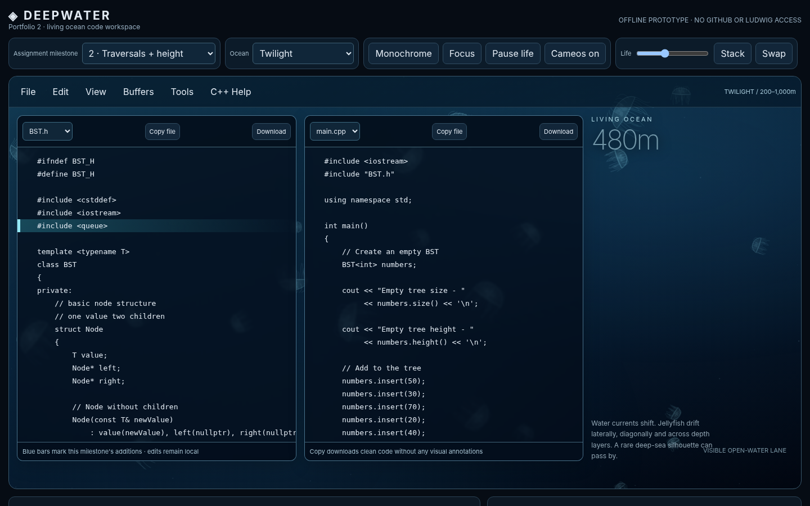](#deepwater) | [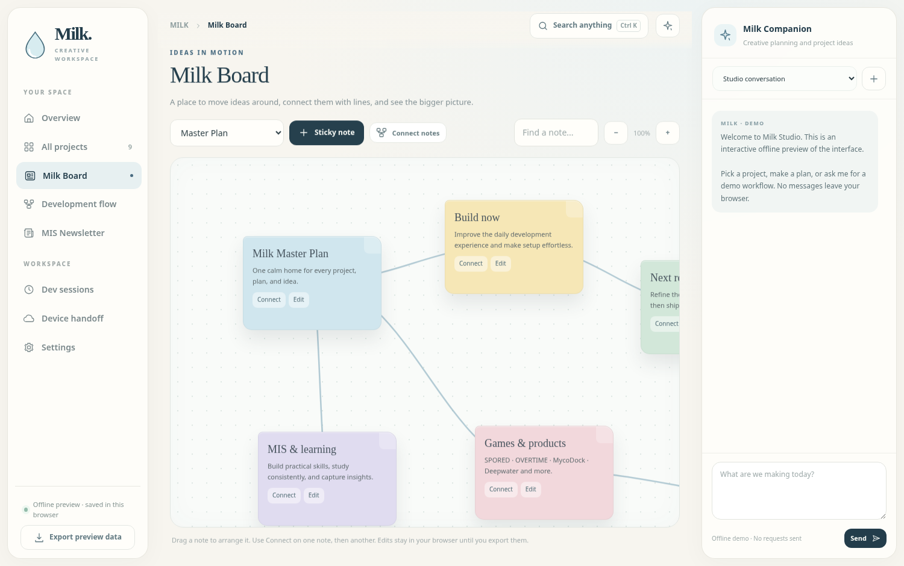](#milk-studio) |
| Dairy Lab · interactive simulation | Footage Organizer · demo workspace |
| [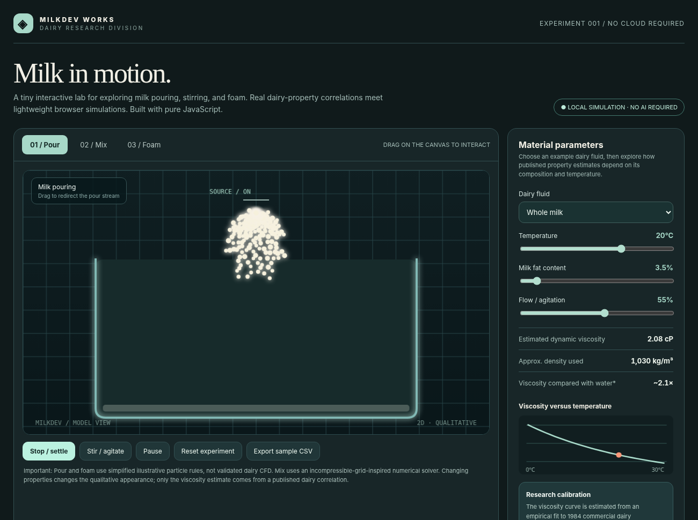](#milkdev-dairy-lab) | [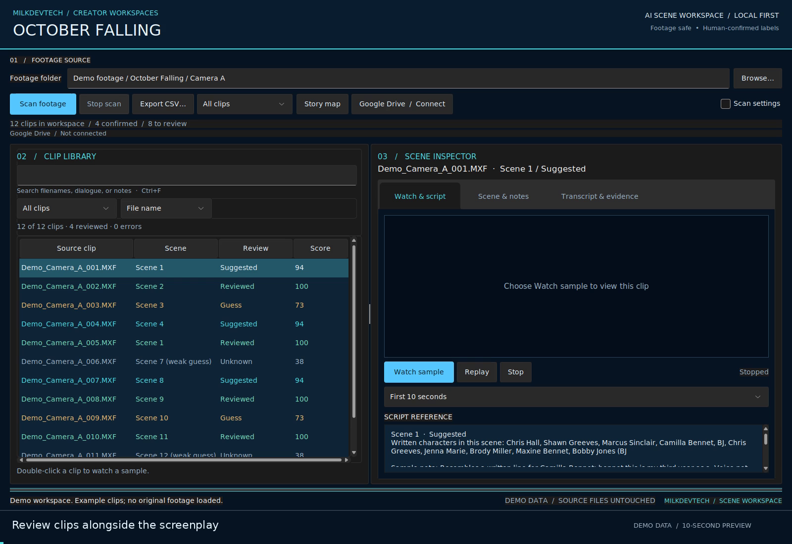](#footage-scene-organizer) |

## Full project index

| Project | What I needed it for | Stage |
| --- | --- | --- |
| [Milk Studio](#milk-studio) | Keep projects, next actions, and AI task planning together | Workspace prototype |
| [Deepwater](#deepwater) | Make C++ practice easier to follow in one focused workspace | Offline interface prototype |
| [Milkdev Dairy Lab](#milkdev-dairy-lab) | Explore physical properties through interactive visual experiments | Browser simulation |
| [Under Commission](#under-commission) | Build a multiplayer world around crafting and consequences | Game in development |
| [OVERTIME](#overtime) | Develop an industrial dark-fantasy world with a consistent visual identity | Game concept / development |
| [Scott County Historical Society website](#scott-county-historical-society-website) | Give visitors one place to find local history and plan a visit | Website project |
| [Data Structures Study Wiki](#data-structures-study-wiki) | Move from reading examples to writing and testing C++ | Independent study tool |
| [Footage Scene Organizer](#footage-scene-organizer) | Match unfamiliar clip names to screenplay scenes | Windows prototype |
| [Milkdev Memory](#milkdev-memory) | Find a note or passage and trace it back to the source | Desktop prototype |
| [Milkdev Vault](#milkdev-vault) | See where files will go before reorganizing a folder | Desktop prototype |
| [Milkdev Ledger](#milkdev-ledger) | Turn transaction exports into readable summaries | Desktop prototype |
| [MycoVault](#mycovault) | Learn retrieval-augmented generation using fungal research | Academic project |
| [C++ Data Structures Portfolio](#c-data-structures-portfolio) | Practice implementing and testing the structures I use | Public source |

## Websites and interfaces

### Scott County Historical Society website

**Why I built it.** The society needed a website visitors could use any time to find practical information and explore local history. I wanted someone planning a visit and someone looking for historical material to each have a clear place to start.

**What it does.** The site organizes visitor information, exhibits, events, membership, and research resources into dedicated pages. I used React and Next.js to build the site around reusable components for navigation, page headings, and recurring content.

### Data Structures Study Wiki

**Why I built it.** When I was studying for CSC 2180, I needed to go from reading about a data structure to explaining it and writing the C++ myself. I wanted the explanation and the practice in the same place.

**What it does.** The wiki connects topics such as recursion, trees, heaps, hashing, and graphs. It includes worked examples, syntax explanations, review questions, and short coding exercises. An online compiler lets me try C++ examples from the browser.

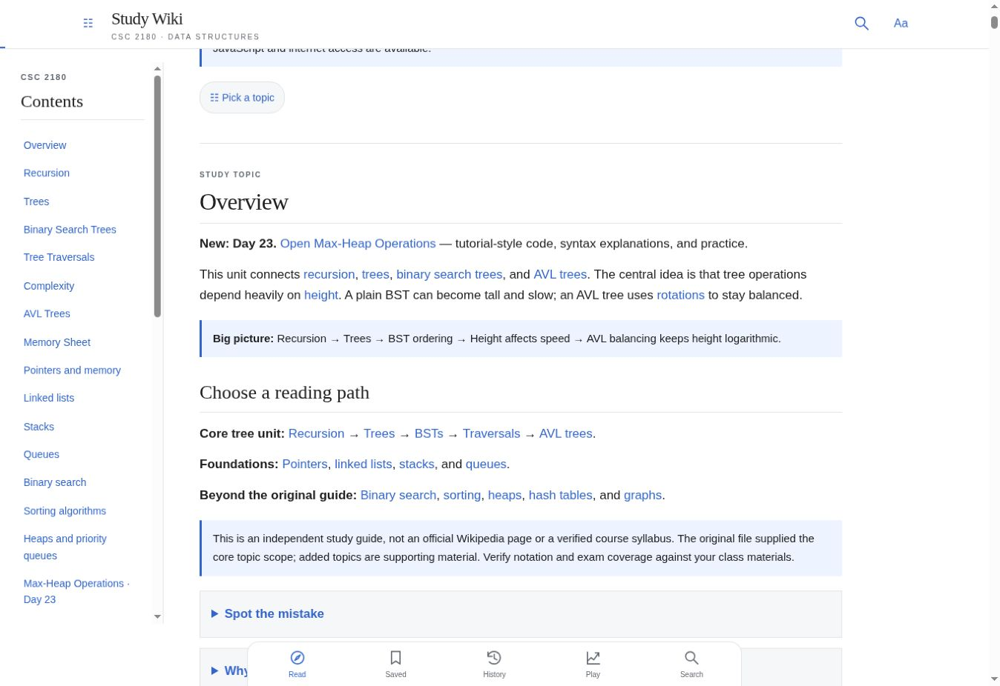

See the tree traversal lesson

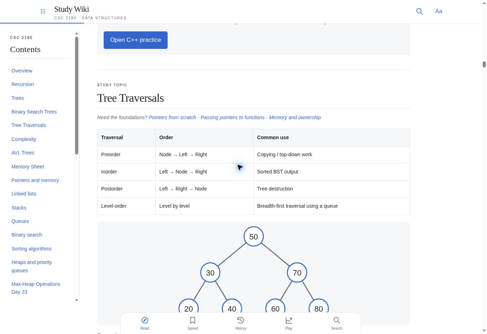

### Deepwater

**Why I built it.** I wanted C++ practice to feel more organized and inviting. Keeping the header, test program, and assignment milestone visible together made it easier to connect an explanation with the code I was working on.

**What this version shows.** An ocean-themed offline interface with side-by-side code panes, milestone selection, focus controls, and file export. This is a prototype screenshot; it does not demonstrate a connected compiler, GitHub session, or remote server.

### Milk Studio

**Why I built it.** With several software and game projects underway, I wanted one place to keep the purpose, next steps, and development context for each project. I also wanted to review an AI task and its estimated cost before running it.

**What these versions show.** The planning-board and project-detail images come from an interactive browser prototype. The agent-queue capture shows a later development interface for reviewing proposed tasks and queued jobs. These are development snapshots from different versions.

Project overview and agent queue

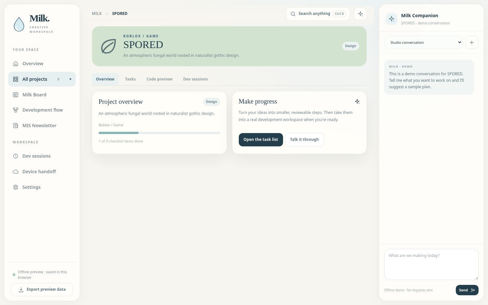

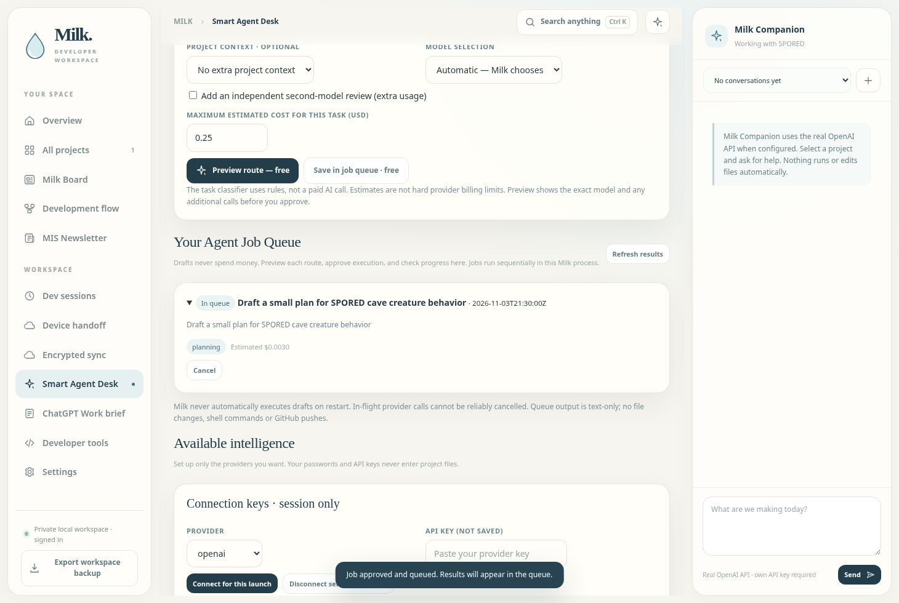

### Milkdev Dairy Lab

**Why I built it.** I wanted to turn curiosity about material properties into something I could experiment with visually. Changing temperature, fat content, and agitation gives a more tangible way to explore the relationship between inputs and a simulation.

**What this version shows.** A JavaScript browser lab with pouring, mixing, and foam modes, adjustable parameters, a viscosity chart, and sample CSV export. The particle visuals are illustrative; this is an exploratory simulation, not validated engineering CFD.

## Desktop tools

### Footage Scene Organizer

**Why I built it.** Reviewing a folder of footage gets slow when the filenames give little indication of what scene a clip belongs to. I wanted a way to check dialogue against a screenplay and carry approved names over to the matching Google Drive files.

**What it does.** The Windows prototype brings clip review, dialogue matching, and scene naming into one workspace. It can export approved old and new filenames in a CSV. A Drive add-on previews the planned renames and checks file identity before applying them.

*Frame from the recorded desktop walkthrough, using example clips with no original footage loaded.*

### Milkdev Memory

**Why I built it.** I wanted to find something I remembered reading across local PDFs and notes, then check the original passage in context.

**What it does.** Memory indexes local documents with SQLite FTS5. Search results show the document, the matching passage, and a page or line reference. I can open the original, copy the passage with its citation, or export results.

**Tools** · Python, Tkinter, SQLite FTS5

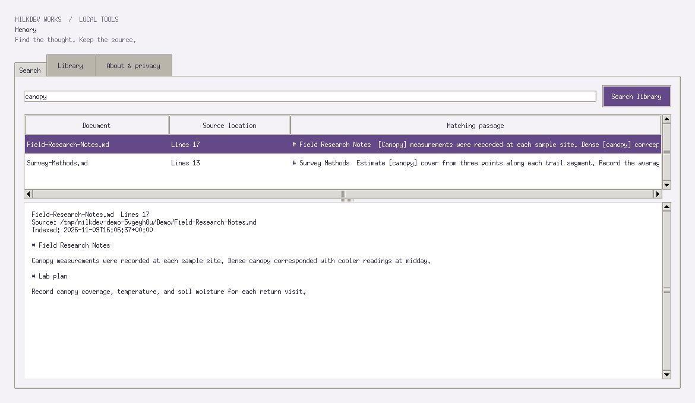

### Milkdev Vault

**Why I built it.** I wanted to clean up folders without losing track of where anything went. Seeing the destination before moving a file and having an undo history were central to the design.

**What it does.** Vault previews file moves grouped by type or month. I can review the proposed destinations, apply selected moves, and use the local SQLite journal to undo eligible moves later.

**Tools** · Python, Tkinter, SQLite

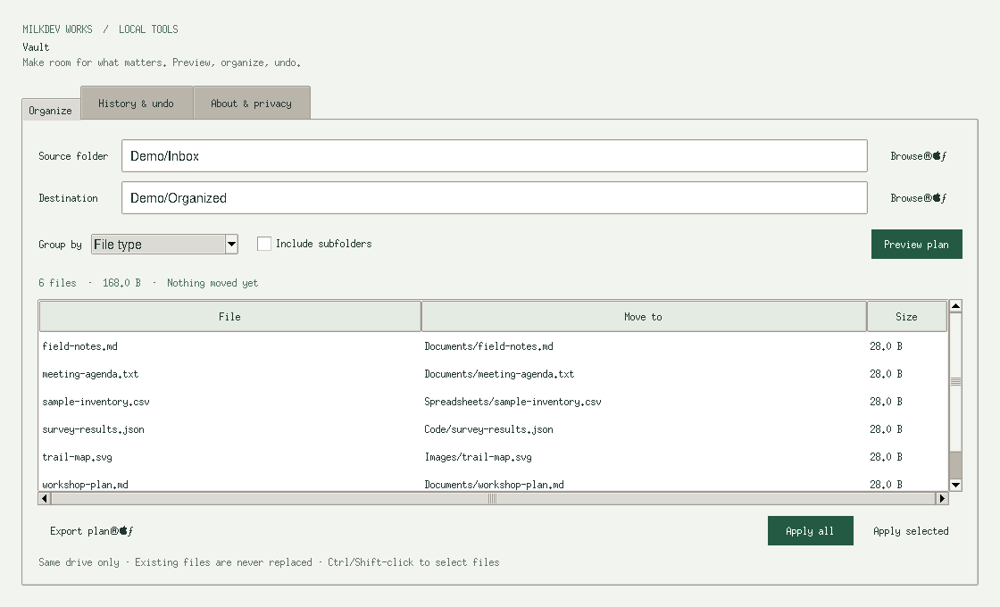

### Milkdev Ledger

**Why I built it.** I wanted a local way to answer basic questions about a transaction export, such as how spending broke down by category that month. CSV exports can use different columns and sign conventions, so I wanted to see how each file would be interpreted before importing it.

**What it does.** Ledger maps and validates CSV or TSV columns, previews normalized amounts, and summarizes income, expenses, and net totals by month and category. It keeps currencies separate and uses decimal arithmetic for totals.

**Tools** · Python, Tkinter, SQLite

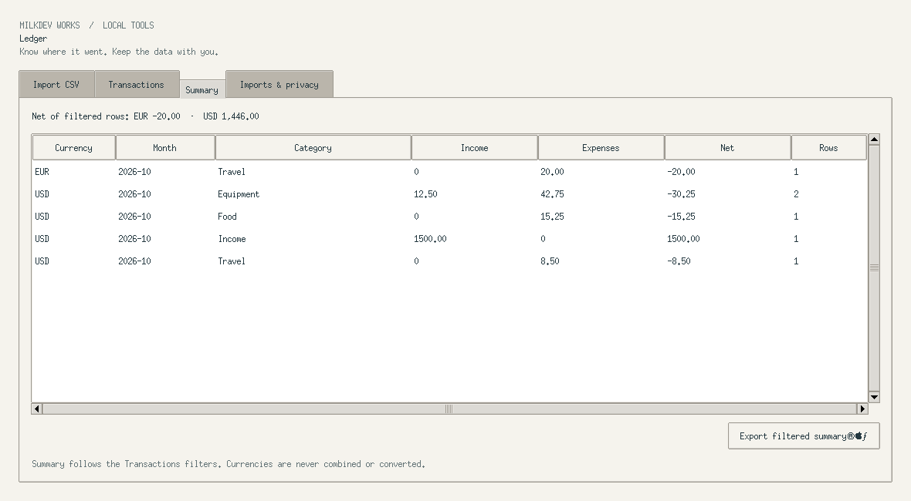

## Coursework and research

### MycoVault

**Why I built it.** I chose fungal genomics for my CSC 3950 project because I wanted to learn AI retrieval using research I was genuinely interested in. It gave me a way to connect programming and data with biology and mycology.

**What it does.** The project chunks and indexes scientific papers, uses embeddings to retrieve relevant passages, and tests whether those passages support the generated answers. I compared retrieval approaches and kept a log of cases where the system missed relevant context or produced unsupported claims.

**Tools** · Python, BGE embeddings, ChromaDB

### C++ Data Structures Portfolio

**Why I built it.** I wanted to understand how data structures behave by implementing the operations myself, then using them in small programs where I could see the effects of my design choices.

**What it includes.** The CSC 2180 portfolio covers linked lists, an undo and redo text buffer, binary search trees, a min-heap, a separate-chaining hash table, and a priority task scheduler. I used small test drivers to check behavior as I built each part.

[Browse the C++ source](https://github.com/MilkdevTech/ds-portfolio)

## Game development and visual direction

### Under Commission

**Why I built it.** I wanted to explore a multiplayer crafting and trading game where selling a product can change a recurring customer and the surrounding world. The project combines progression, physical workstations, and an atmospheric city.

**What this preview shows.** A material palette for Veyr: weathered masonry, aged metals, roofing, timber, and canvas. This is an asset preview, not an in-game screenshot. The source remains private, and the game is still in development.

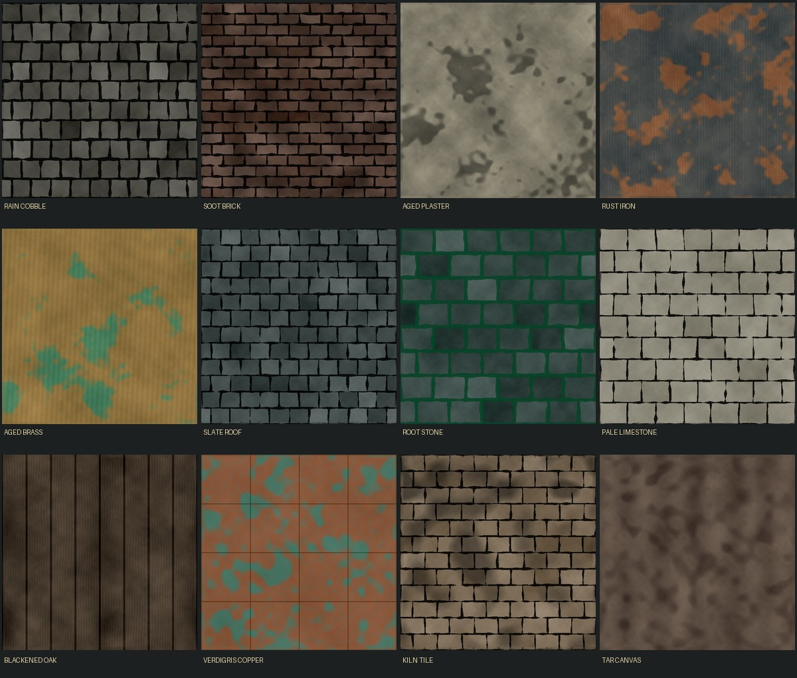

### OVERTIME

**Why I built it.** I wanted to develop an industrial dark-fantasy game where machinery, architecture, and the story feel like parts of the same world. A shared visual reference helps keep environments, characters, and interactive props consistent.

**What I built.** A first-person Unity and C# prototype set inside Morrow Works. The slice starts in the Workshop, where the player can talk to Mara and use a crafting bench, then moves into Assembly for wrench combat, salvage, and a Foreman encounter.

**Implementation.** An editor tool builds the Workshop and Assembly scenes. Separate components handle interactions, combat, checkpoints, and world state.

---

Memory, Vault, and Ledger screenshots use fictional data. Other images are labeled by their source and development stage. Private source repositories are not included in this showcase.

